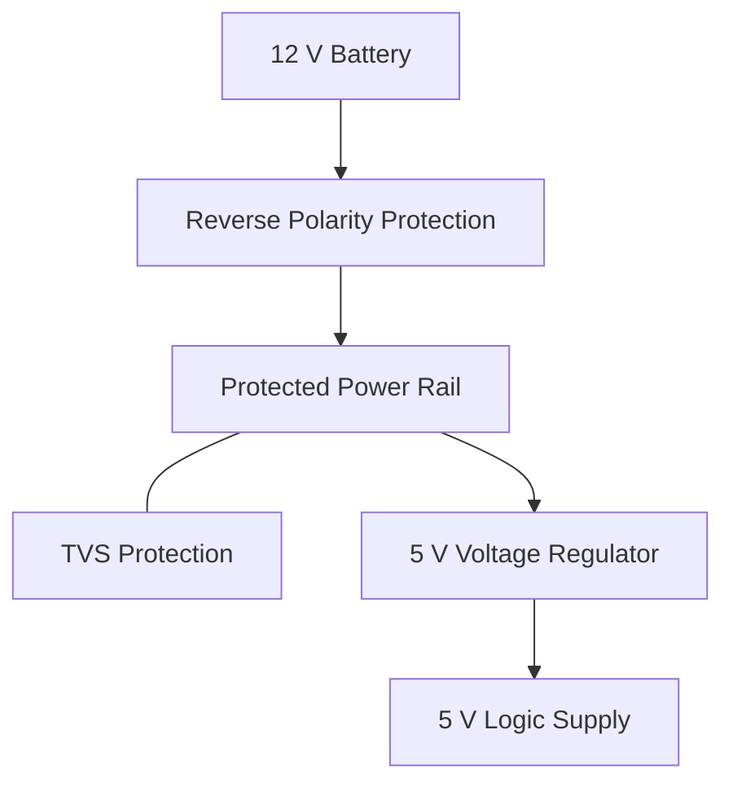
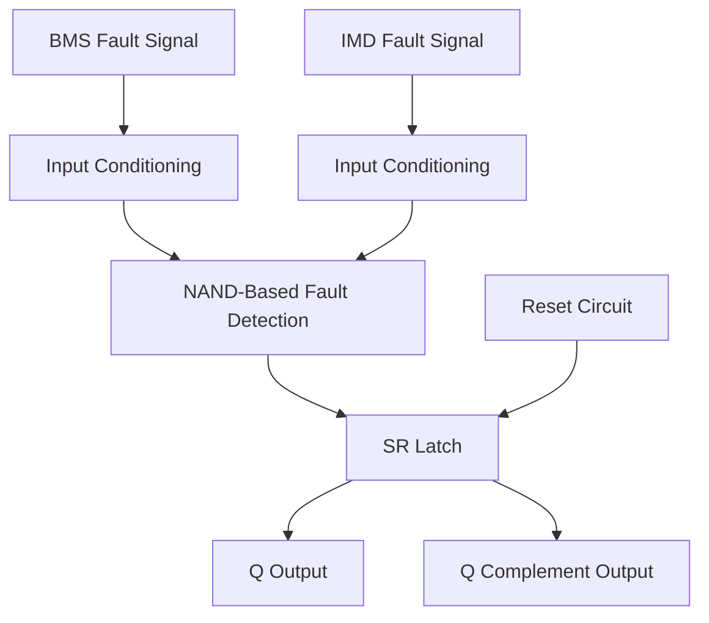

# TSSI Safety PCB

## Project Overview

A custom safety and fault detection PCB designed in KiCad
as part of the Formula SAE Electrical Team onboarding
project at the University of Texas at Dallas.

The PCB was designed from provided system requirements
to implement power protection, input signal conditioning,
hardware-based fault detection, and fault latching logic.

The schematic, component selection, PCB layout, and routing
were independently developed as part of the onboarding project.

## Key Features

- 12 V battery power input
- PMOS-based reverse polarity protection
- TVS diode transient voltage suppression
- 5 V voltage regulation
- BMS and IMD fault signal conditioning
- Voltage divider and RC filtering circuits
- NAND-based fault detection logic
- Hardware-based SR latch
- Power-on reset circuitry
- Custom two-layer PCB designed in KiCad

## System Architecture

### Power Distribution



### Fault Detection and Latching



## Hardware Design

### Power Protection and Regulation

The power input circuitry incorporates a PMOS transistor
for reverse polarity protection and a TVS diode for
transient voltage suppression. A voltage regulator
provides a 5 V supply for the digital logic circuitry.

### Input Signal Conditioning

The BMS and IMD fault inputs are conditioned using
resistive voltage dividers and RC low-pass filters.
The voltage dividers reduce the input voltage to a
logic-compatible level, while the RC filters are
intended to reduce high-frequency noise.

### Fault Detection Logic

NAND-based combinational logic processes the conditioned
BMS and IMD fault signals to determine whether a fault
condition is present.

| BMS Input | IMD Input | System Condition |
| --- | --- | --- |
| HIGH | HIGH | No Fault |
| HIGH | LOW | Fault |
| LOW | HIGH | Fault |
| LOW | LOW | Fault |

### Hardware Fault Latch

A cross-coupled NAND-based SR latch is used to retain
a detected fault condition independently of subsequent
changes in the input signals.

A power-on reset circuit is included to initialize
the latch to a defined state during startup.

## PCB Design

The schematic and PCB layout were developed in KiCad.

### Design Considerations

- Power protection and distribution
- Input voltage level conditioning
- Signal filtering
- Hardware-based fault retention
- Power supply decoupling
- Component placement and signal routing
- Separate trace widths for power and logic signals

### Schematic


### Front Copper Layer


### Back Copper Layer


### 3D PCB Render


The native KiCad project, schematic, and PCB layout
files are available in the [Hardware](Hardware/) directory.

Additional component libraries are provided as ZIP
archives and can be extracted and imported into KiCad
as needed.

## Design Documentation

Handwritten engineering notes developed throughout
the design process are available in the
[Documentation](Documentation/) directory.

The documentation covers:

- Fault detection truth tables
- SR latch logic and circuit development
- Input voltage conditioning
- RC filtering
- Power distribution architecture
- PCB trace width selection

## Repository Structure

```
TSSI-Safety-PCB/
├── Hardware/
│   ├── pcb1.kicad_pro
│   ├── pcb1.kicad_sch
│   ├── pcb1.kicad_pcb
│   ├── pcb1.pdf
│   ├── SMBJ13A.zip
│   └── ul_SI4143DY-T1-GE3.zip
├── Documentation/
│   └── Design-Notes.pdf
└── README.md
```

## Project Status

The component selection, schematic design, PCB layout,
and routing have been completed in KiCad as part of
the Formula SAE Electrical Team onboarding project.
The PCB has not yet been fabricated or physically
validated. Future development would involve hardware
assembly, electrical testing, and verification of
the protection and fault detection circuitry.

## Future Improvements

- Fabricate and assemble the PCB
- Validate power protection circuitry
- Verify input conditioning and logic voltage levels
- Test fault detection and latching behavior
- Validate power-on reset timing and startup behavior

## Tools and Technologies

- KiCad
- PCB Design
- Digital Logic
- MOSFET Circuitry
- Voltage Regulation
- RC Filtering
- Hardware Fault Detection
- Sequential Logic
